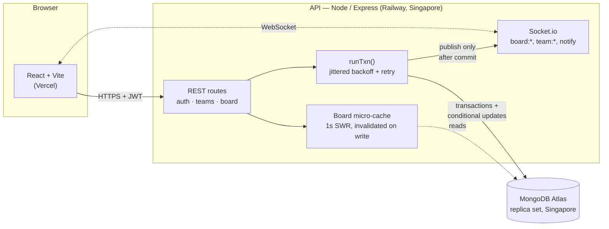
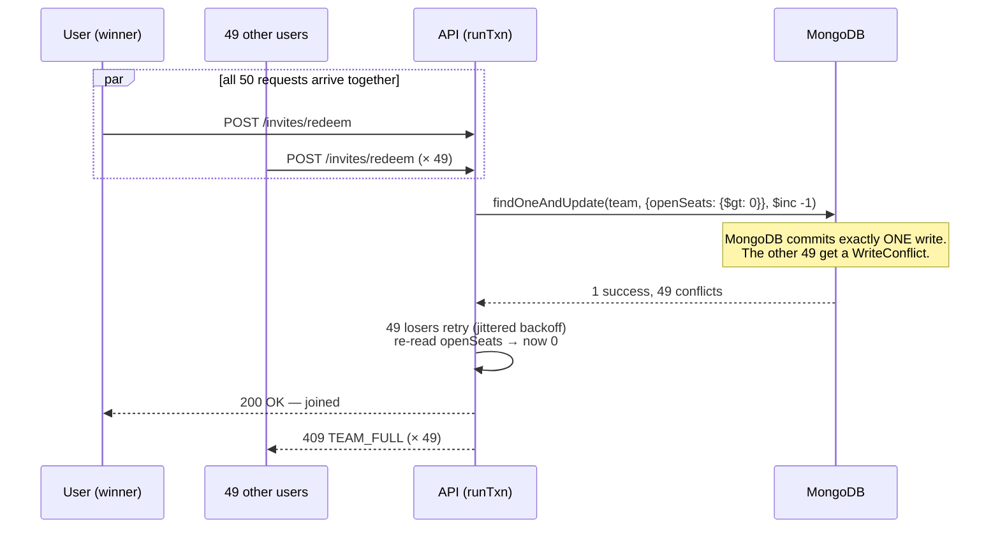
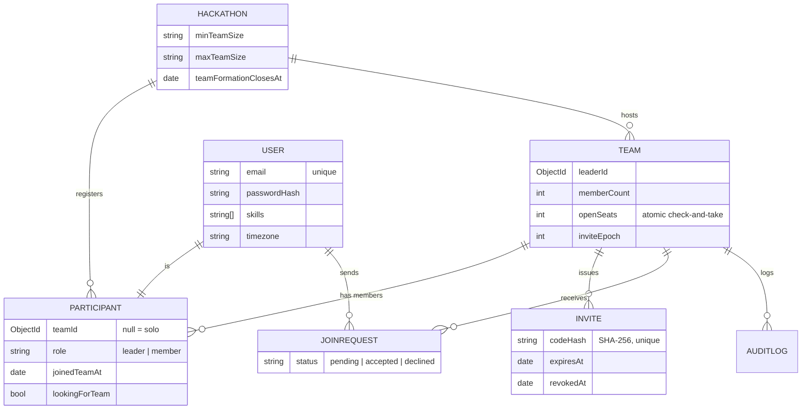

# TeamUp — race-proof team formation

[](https://github.com/PawanBhandari03/TeamUp-Hack4Hack/actions/workflows/ci.yml)
[](https://teamup-three-tau.vercel.app)
[](https://hack4hack-entry-production.up.railway.app/health)


A production-grade team-formation service for a 10,000-participant hackathon, built for the **Hack4Hack Crew Hiring Challenge 2026 (Problem 1)**.

People create teams, invite others with expiring codes, request to join (the leader accepts or declines), and find each other on a live "looking for teammates" board. **When 50 people click "join" for the last seat at the same instant, exactly one gets it — proven by a test, and re-proven live on the deployed app.**

| | |
|---|---|
| 🔗 **Live app** | **[teamup-three-tau.vercel.app](https://teamup-three-tau.vercel.app)** |
| 🔗 **API** | [hack4hack-entry-production.up.railway.app](https://hack4hack-entry-production.up.railway.app/health) (Railway, Singapore) |
| 👤 **Demo logins** | `demo1@hack4hack.dev` … `demo5@hack4hack.dev`, password `password123` |
| 📄 **Design doc (1 page)** | [docs/DESIGN.md](docs/DESIGN.md) |
| 📊 **Load-test report** | [docs/LOADTEST.md](docs/LOADTEST.md) |
| 🚀 **Deploy guide** | [docs/DEPLOY.md](docs/DEPLOY.md) |

## Contents

- [Highlights](#highlights)
- [Architecture](#architecture)
- [How the race is won](#how-the-race-is-won-the-hard-requirement)
- [Data model](#data-model)
- [Run it](#run-it)
- [API](#api)
- [Project layout](#project-layout)
- [Honest notes](#honest-notes-whats-missing)

## Highlights

| Requirement | Where / proof |
|---|---|
| Race-proof last seat (50 → exactly 1) | MongoDB transactions + conditional updates, [`teamService.js`](server/src/services/teamService.js) · [`tests/race.test.js`](server/tests/race.test.js) · **re-run live against the deployed app** (see [overview.md](overview.md#step-29--deployed-14-nov)): 49 × `TEAM_FULL`, 1 joined, integrity clean |
| Idempotent retries | `Idempotency-Key` middleware + data-model backstop · [`idempotency.js`](server/src/middleware/idempotency.js) |
| Real-time board and team pages | Socket.io, events published only after commit · [`socket.js`](server/src/socket.js) |
| Team rules | min/max size, 1 team per person, expiring codes, leader hand-off, team deleted when empty |
| Security | JWT (HS256 pinned), bcrypt, leader-only actions, 50-bit hashed invite codes, rate limits, zod validation everywhere |
| Audit log | who / what / when, written in the same transaction |
| Teammate suggestions | `0.7 × missing-skill coverage + 0.3 × timezone closeness`, with a per-result breakdown |
| Tests + CI | **45 API tests** (Vitest + Supertest on a real MongoDB replica set) + **5 browser tests** (Playwright: live updates across 2 browsers, phone layout, keyboard-only, axe accessibility), all in GitHub Actions |
| Seed | 10,000 users + 2,000 teams |
| Load test | 100 concurrent users (k6-style VUs): board **p95 12 ms** on 1 vCPU (target < 200 ms); re-run against the live deployment in [LOADTEST.md §D](docs/LOADTEST.md) |
| UI | React, newspaper-classifieds design, works on phones, keyboard-only accessible |
| **Bonus** | Optimistic UI with rollback · `docker compose up` (fully offline) · Prometheus `/metrics` · **chaos test** (SIGKILL mid-join → 0 integrity violations) |

## Architecture



Every write goes through one transaction helper (`runTxn`) so a crash mid-request can never leave a half-done join — see the [chaos test](server/tests/chaos.test.js). Socket.io events are only emitted **after** that transaction commits, so a rolled-back change is never broadcast to clients.

## How the race is won (the hard requirement)

Fifty people click "join" on a team with exactly one seat left, at the same instant:



No locks, no queue — the database's own conditional write is the only thing deciding the winner. This is re-run against the **live deployed app** as part of the submission (`npm run race-demo`): 49 × `TEAM_FULL`, 1 joined, `npm run verify` reports 0 integrity violations.

## Data model



`Participant` has a **unique index on `{hackathonId, userId}`** (one team per person) and `JoinRequest` a **partial unique index on `{teamId, userId}` where `status = pending`** (no duplicate pending requests). `openSeats` is stored, not computed — that's what turns "check, then take" into one atomic update. Full details and every trade-off in [docs/DESIGN.md](docs/DESIGN.md).

## Run it

### Option A: one command, fully offline (Docker)

```bash
docker compose up --build
```
UI at http://localhost:8080 and API at http://localhost:4000 (`/health`, `/metrics`). The database is seeded with 10k users automatically on first start.

### Option B: dev mode

Requires Node ≥ 20 and a MongoDB **replica set** (Atlas free tier works). Transactions don't run on a standalone mongod.

```bash
# API
cd server
cp .env.example .env        # set MONGODB_URI and JWT_SECRET
npm install
npm run seed                # 10,000 users, 2,000 teams (wipes the DB!)
npm run dev                 # http://localhost:4000

# UI (second terminal)
cd client
npm install
npm run dev                 # http://localhost:5173 (uses VITE_API_URL, default http://localhost:4000)
```

### Scripts (in `server/`)

| Command | What it does |
|---|---|
| `npm test` | 45 API tests, including race, real-time, metrics and chaos tests (in-memory MongoDB replica set; no setup needed) |
| `npm run seed` | Wipe and seed 10,000 users / 2,000 teams |
| `npm run loadtest` | Virtual-user, burst and saturation load tests, exact p95 (`TARGET=…` to point elsewhere) |
| `npm run verify` | Check every invariant (member counts, seats, one leader, no orphans) against the DB |
| `npm run race-demo` | 50 real users race for the last seat over HTTP against any deployment (`TARGET=…`) |
| `npm run smoke` | Read-only post-deploy check: health, login, board, CORS, WebSocket (`TARGET=… ORIGIN=…`) |
| `npm run lint` | oxlint, zero warnings allowed |

Browser tests (needs a running stack, e.g. `docker compose up`): `cd e2e && npm ci && npx playwright install chromium && BASE_URL=http://localhost:8080 npx playwright test`

## API

All endpoints are under `/api`. Every endpoint except register, login and the hackathon list needs `Authorization: Bearer <jwt>`. Mutations accept an `Idempotency-Key` header. Errors look like `{ "error": { "code": "TEAM_FULL", "message": "…" } }`.

| Method | Path | Notes |
|---|---|---|
| POST | `/auth/register`, `/auth/login` | rate-limited |
| GET / PATCH | `/auth/me` | profile: skills, timezone, bio |
| GET | `/hackathons` | public |
| GET / PATCH | `/hackathons/:id/me` | my team and requests; toggle `lookingForTeam` |
| GET | `/hackathons/:id/board/teams` · `/board/people` | `?limit&cursor&skill`, cursor-paginated |
| GET | `/hackathons/:id/stats` | headline numbers: teams recruiting, open seats, people looking, most-wanted skills (cached ~1 s) |
| GET | `/hackathons/:id/suggestions` | people for my team, or teams for me |
| POST | `/hackathons/:id/teams` | create a team (creator becomes leader) |
| GET / PATCH | `/teams/:id` | details (leader also sees requests); edit is leader-only |
| GET | `/teams/:id/audit` | members only |
| POST | `/teams/:id/leave` | leader hand-off; team deleted when empty |
| DELETE | `/teams/:id/members/:userId` | leader only |
| POST | `/teams/:id/leader` | transfer leadership |
| POST / DELETE | `/teams/:id/invites` | generate (revokes old) / revoke codes |
| POST | `/invites/redeem` | `{ code }`, 10 tries / 15 min |
| POST | `/teams/:id/requests` | request to join |
| POST | `/requests/:id/accept` · `/decline` · `/cancel` | |

**Socket.io events:** `board:team`, `board:team-removed`, `board:person` (hackathon room) · `team:updated`, `team:requests`, `team:deleted` (members only) · `me:updated`, `notify` (private).

## Project layout

```
server/
  src/models/          data model + indexes
  src/services/        teamService (all rules, race-proof), boardService, suggestionService
  src/middleware/      auth, zod validation, idempotency, rate limits, errors
  src/lib/             transactions, realtime publish, invite codes, metrics, integrity checker
  tests/               race, chaos, realtime, teams, auth, board tests
  scripts/             seed, loadtest, verify-integrity, race-demo, smoke
client/src/            api.js (idempotent fetch), state.jsx (socket), pages/
docs/                  DESIGN.md, LOADTEST.md, DEPLOY.md, raw load-test JSON
```

## Honest notes: what's missing

- Single API instance. Scaling out needs the Socket.io Redis adapter and a shared cache (see the design doc).
- The JWT lives in localStorage with a 7-day expiry. Production should use short-lived tokens plus refresh cookies.
- The minimum team size is shown ("forming" / "meets minimum") but not enforced on leave. A "finalize team" step would enforce it.
- Free-tier hosting (Render 0.1 CPU, Atlas M0 at about 100 ops/s) limits throughput on the cheapest possible tier — documented, measured and the reason Railway + Singapore were chosen instead. See [docs/LOADTEST.md](docs/LOADTEST.md).
